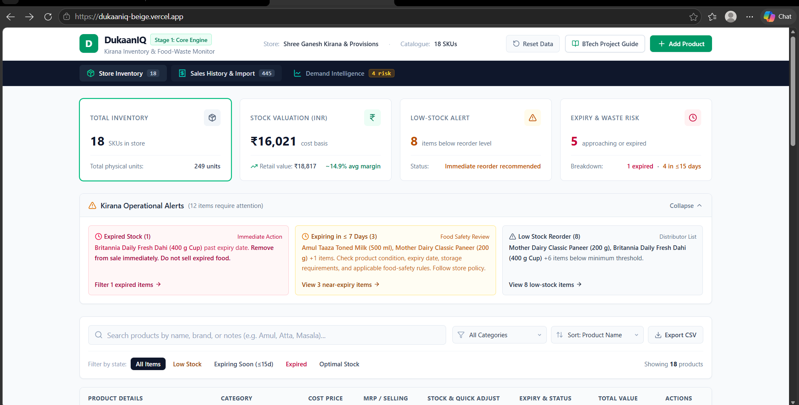
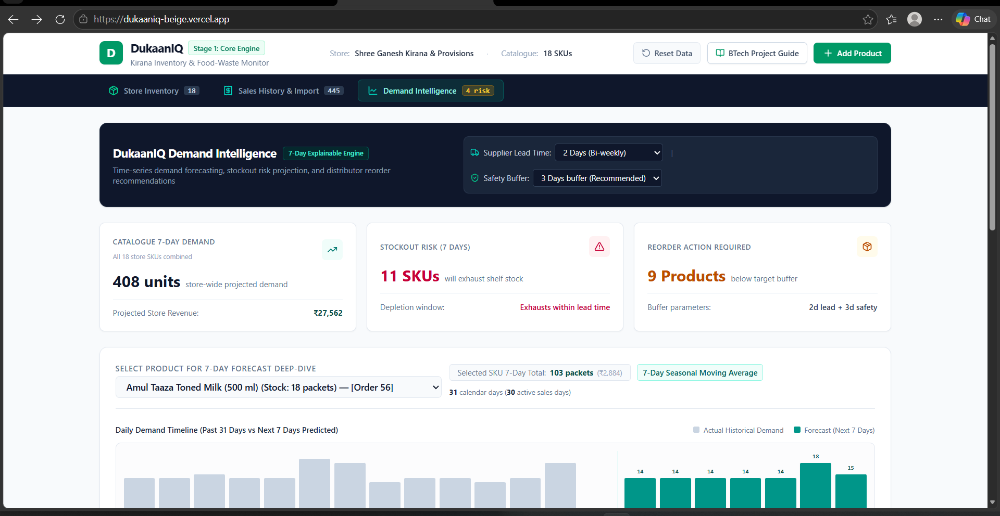
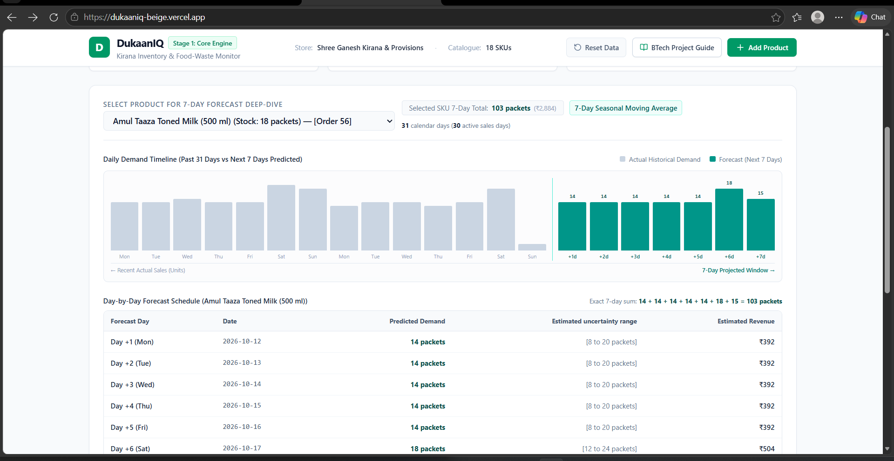
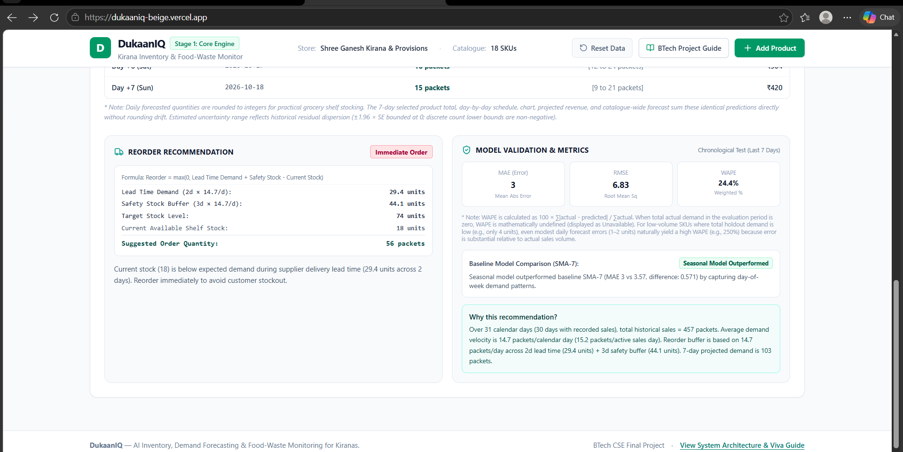
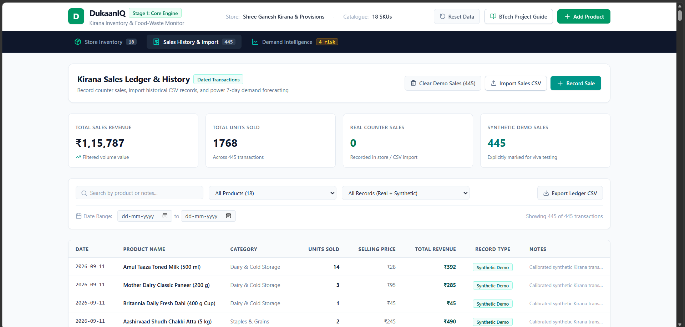
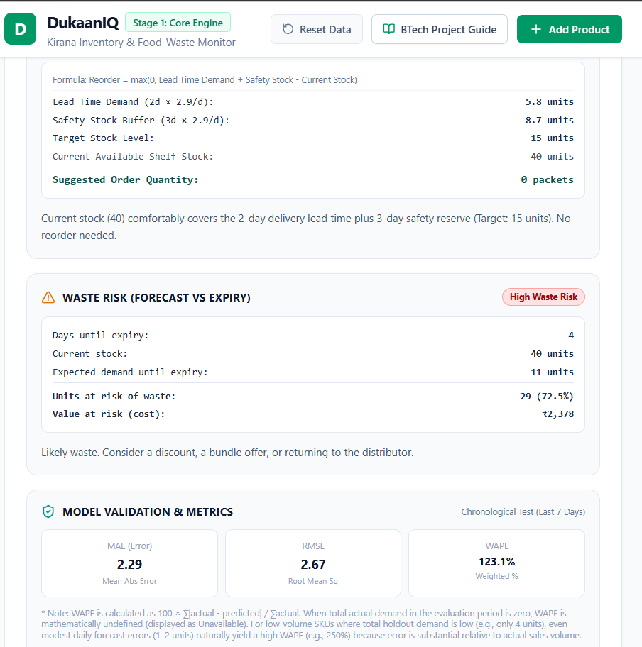

# DukaanIQ: Kirana Inventory & Food-Waste Monitor

[](https://github.com/dmatharv25-cmd/dukaaniq/actions/workflows/ci.yml)

**Live demo:** https://dukaaniq-beige.vercel.app/

A client-side web app for Indian kirana stores that tracks inventory, flags expiring stock, and forecasts demand so shopkeepers can reorder the right quantity at the right time.

## Features

**Stage 1: Inventory engine**
- Live stock counts for 18 sample kirana products
- Valuation at wholesale cost and retail value, with margin %
- Expiry tracking (expired, expiring within 15 days, shelf life remaining)
- Low-stock alerts and operational alert banners
- Add, edit and delete products

**Stage 2: Demand intelligence**
- Sales ledger with Record Sale and CSV import
- 7-day demand forecast using day-of-week seasonal smoothing
- Chronological train/test split (no future data leakage)
- Comparison against a 7-day moving-average baseline using MAE, RMSE and WAPE
- Waste-risk predictor: compares forecast demand with each product's expiry date to estimate units and rupee value likely to go unsold
- Reorder recommendation: `max(0, lead time demand + safety stock - current stock)`, with adjustable lead time and safety days

## Screenshots

**Dashboard: valuation, low-stock and expiry alerts**



**Demand intelligence: store-wide outlook and stockout risk**



**7-day forecast for a selected product**



**Reorder recommendation and model validation (seasonal vs SMA-7 baseline)**



**Sales ledger with CSV import and synthetic-data labels**


**Waste-risk predictor: forecast demand vs expiry date**



## Tech stack

React 19, TypeScript, Vite, Tailwind CSS. All forecasting runs in the browser, with no backend.

## Run locally

Requires Node.js.

```
npm install
npm run dev
```

Then open http://localhost:3000.

## Tests

```
npm test
```

Runs 86 automated checks covering forecasting, error metrics, reorder logic, waste-risk prediction and CSV validation.

## Sales CSV format

Headers: `date` (YYYY-MM-DD), `product` (name or ID), `quantity`, and optional `unit_price`. An example file can be downloaded from the import dialog.

## Note on data

The 445 demo sales transactions are synthetic and are labeled as such in the app. They exist only to demonstrate and test the forecasting engine.


## Limitations & Future Work

**Current limitations**
- All 445 demo sales are synthetic, so forecast accuracy has not been validated on real store data.
- Model evaluation uses a single 7-day chronological holdout, which is a small sample. WAPE is unstable for slow-moving items.
- The forecast uses day-of-week seasonality only. It does not model promotions, festivals or price changes.
- Data is stored in the browser, with no backend, login or multi-device sync.

**Planned work**
- Validate the models on a public retail dataset or anonymised data from a real kirana store.
- Add persistent storage with user accounts.
- Hindi/English interface and CSV export of forecasts.


